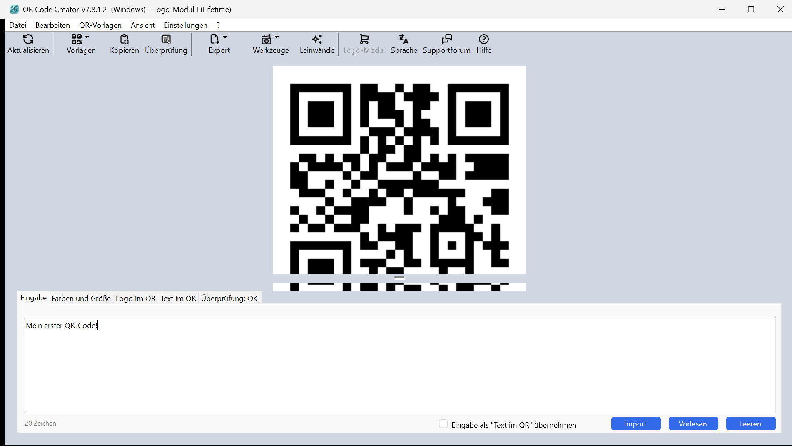

# QR Code Creator Patch

## What It Does

- Writes a valid license into QR Code Creator's config XML (`%APPDATA%\QR Code Creator.exe.xml`)
- Activates lifetime license (License valid until 01.01.2099)
- Logo-Modul I included — no nag screens, no registration prompts
- Exe stays untouched — license is stored in the app's own config file

## How It Works

The DLL masquerades as `msvcr120.dll` (Visual C++ 2013 runtime) and sits alongside `QR Code Creator.exe`. On launch it:

1. Reads the app's config XML from `%APPDATA%`
2. Inserts/updates license keys: `LizenzWin1`, `LizenzWinOK`, `LizenzWinOKfirma`, `LizenzDatum`
3. Creates the config file with a valid license if it doesn't exist yet
4. Forwards all runtime calls to the real `msvcr120_orig.dll`

## Screenshot

## Installation

1. Drop DLL (compiled from this source) in the install folder
2. Run `QR Code Creator.exe` — that's it

## Notes

- Built for **QR Code Creator V7.8.1.2 x64** only. Other builds may not work.
- You must rename the original `msvcr120.dll` to `msvcr120_orig.dll`.
- Deletes `%APPDATA%\QR Code Creator.exe.xml` to reset the license if needed.
- AV may flag the DLL — false positives are common with DLL proxy tools.
- For educational purposes only.

## Disclaimer

This project is for **educational and research purposes only**. Use at your own risk. The author is not responsible for any misuse or damage.

---

Cracked by **github.com/ofkits1**
